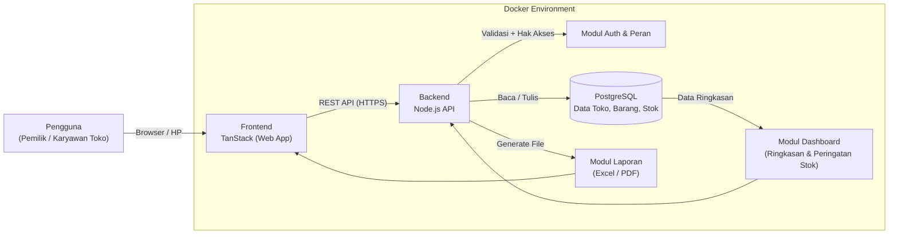
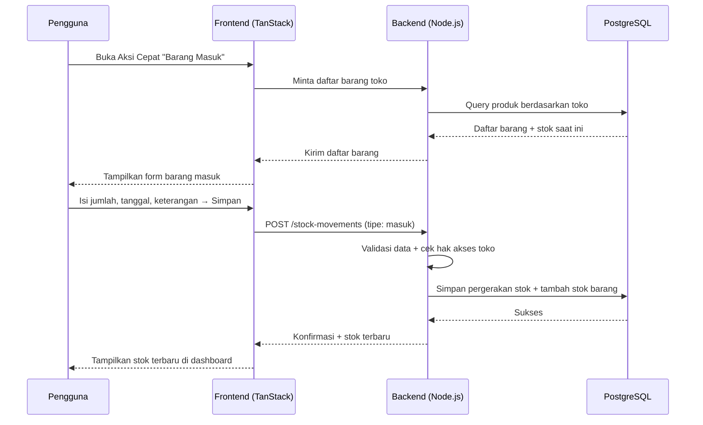
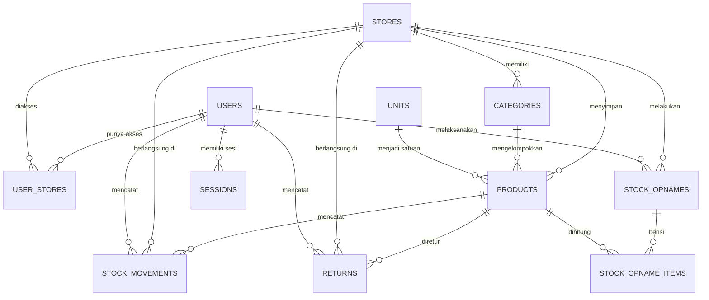

# PRD — Project Requirements Document

## 1. Overview

**Masalah yang diselesaikan**
Pemilik usaha kecil yang mengelola beberapa toko sekaligus — pada kasus ini lima toko: **Toko Pupuk, Toko Bangunan, Toko ATK, Toko Listrik, dan Toko Furniture** — saat ini mencatat stok di buku tulis, file Excel, atau catatan biasa di HP. Akibatnya:

- Stok tiap toko tidak terpantau dalam satu tempat, sehingga sulit tahu barang mana yang harus segera dibeli.
- Catatan masuk dan keluar barang sering tidak sinkron dengan kondisi fisik di gudang.
- Barang retur (dari pelanggan atau ke pemasok) tidak tercatat rapi.
- Membuat laporan stok harus dihitung manual dan memakan waktu.

**Tujuan utama aplikasi**
Membangun aplikasi web _stock management_ multi-toko yang:

1. Menampilkan **dashboard** kondisi stok kelima toko dalam satu layar, lengkap dengan peringatan stok menipis.
2. Menyediakan **halaman khusus pencatatan stok**: barang masuk, barang keluar, dan retur.
3. Menyediakan **fitur laporan** yang bisa difilter dan **diekspor** ke Excel/PDF dengan mudah.
4. Menyediakan **stock opname** untuk mencocokkan catatan sistem dengan hasil hitung stok fisik.
5. Menjaga data tetap aman lewat **akun dan hak akses** per toko.

**Nilai jual utama:** _laporan gampang_ — pemilik bisa melihat dan membagikan laporan stok tanpa hitung manual.
**Kebiasaan pengguna yang ingin didukung:** _cek stok tiap hari_, sehingga dashboard harus cepat diakses, termasuk dari HP.
**Kemenangan pertama (first win):** pengguna berhasil **mencatat barang masuk pertama** dan langsung melihat stoknya bertambah di dashboard.

---

## 2. Requirements

**Persyaratan fungsional**

| No  | Persyaratan             | Keterangan                                                                                                                          |
| --- | ----------------------- | ----------------------------------------------------------------------------------------------------------------------------------- |
| F1  | Multi-toko              | Aplikasi menangani **lima toko** (Pupuk, Bangunan, ATK, Listrik, Furniture) dengan data stok terpisah namun bisa dilihat bersamaan. |
| F2  | Dashboard ringkas       | Satu layar menampilkan ringkasan tiap toko: jumlah barang & nilai stok.                                                             |
| F3  | Peringatan stok menipis | Barang di bawah batas minimum ditandai otomatis.                                                                                    |
| F4  | Pencatatan stok         | Barang masuk, barang keluar, retur, dan penyesuaian tercatat dengan tanggal, jumlah, dan keterangan.                                |
| F5  | Akurasi stok            | Setiap catatan langsung memperbarui jumlah stok barang terkait.                                                                     |
| F6  | Koreksi catatan         | Catatan yang salah bisa diubah atau dibatalkan tanpa merusak data lain.                                                             |
| F7  | Stock opname            | Bisa memasukkan hasil hitung fisik, melihat selisih, lalu menyesuaikan stok sistem.                                                 |
| F8  | Laporan & ekspor        | Laporan stok per toko dan mutasi barang, dengan filter periode, dapat diunduh sebagai Excel & PDF.                                  |
| F9  | Akun & hak akses        | Login email + kata sandi; hak akses dibatasi per toko.                                                                              |
| F10 | Pengelolaan toko        | Nama dan data tiap toko dapat diubah, serta penambahan toko baru.                                                                   |

**Persyaratan non-fungsional**

- **Mudah dipakai orang non-teknis** — istilah berbahasa Indonesia, alur sesingkat mungkin (catat barang masuk maksimal beberapa langkah).
- **Responsif** — dashboard dan form pencatatan nyaman dipakai dari HP karena kebiasaan cek stok harian.
- **Cepat** — dashboard lintas lima toko tampil dalam hitungan detik.
- **Aman** — data hanya bisa diakses pengguna yang berhak; kata sandi tersimpan terenkripsi.
- **Tertelusur** — setiap perubahan stok mencatat siapa dan kapan.
- **Mudah dipasang** — berjalan di dalam Docker sehingga bisa dipindah atau dicadangkan dengan mudah.

**Batasan (constraints)**

- Tech stack **dikunci**: TanStack (frontend), Node.js (backend), PostgreSQL (database), Docker (deployment). Tidak ada penggantian stack.
- Tidak ada integrasi pihak ketiga (payment, marketplace) pada versi ini.
- Tidak ada fitur tambahan di luar roadmap yang disepakati.

**Asumsi**

- Satu akun dapat memiliki akses ke satu atau beberapa toko.
- Satu barang hanya dimiliki oleh satu toko (katalog per toko).
- Harga barang disimpan sebagai harga acuan (bukan harga jual per transaksi).

---

## 3. Core Features

Fitur disusun mengikuti fase roadmap yang sudah disetujui.

### Fase 1 — Fondasi Pelacakan Stok

**1. Dashboard Stok** _(prioritas: high)_
Melihat kondisi stok kelima toko sekilas agar cepat tahu barang mana yang perlu dibeli.

- **Ringkasan Lima Toko** — jumlah barang dan nilai stok tiap toko dalam satu layar.
- **Peringatan Stok Menipis** — barang di bawah batas minimum ditandai jelas.
- **Pencarian Barang Cepat** — mencari barang lintas toko dengan nama atau kode.
- **Aksi Cepat Barang Masuk** — mencatat barang masuk langsung dari halaman utama.

### Fase 2 — Katalog & Pencatatan Pergerakan Barang

**2. Katalog Barang** _(prioritas: high)_
Menyimpan daftar barang lengkap tiap toko sebagai sumber data stok yang rapi.

- **Daftar Barang per Toko** — semua barang yang terdaftar di tiap toko.
- **Tambah & Ubah Barang** — menambah barang baru atau memperbarui nama, kode, dan harga.
- **Kategori & Satuan** — mengelompokkan barang berdasarkan kategori dan satuan (karung, pcs, dsb.).
- **Batas Stok Minimum** — mengatur ambang minimum tiap barang agar peringatan muncul tepat waktu.

**3. Catat Barang Masuk & Keluar** _(prioritas: high)_
Mencatat setiap barang masuk dan keluar agar jumlah stok selalu akurat.

- **Form Barang Masuk** — mengisi barang datang dari pemasok beserta jumlah dan tanggal.
- **Form Barang Keluar** — mencatat barang keluar untuk penjualan atau pemakaian.
- **Riwayat Pergerakan Stok** — semua catatan masuk dan keluar secara berurutan.
- **Perbaiki Catatan Salah** — mengubah atau membatalkan catatan keliru agar stok tetap benar.

### Fase 3 — Retur & Stock Opname

**4. Retur Barang** _(prioritas: medium)_
Mencatat barang yang dikembalikan agar stok dan catatan sesuai kenyataan.

- **Retur ke Pemasok** — mengembalikan barang rusak atau salah kirim ke pemasok (stok berkurang).
- **Retur dari Pelanggan** — mencatat barang yang dikembalikan pelanggan dan menambah stoknya kembali.
- **Riwayat Retur** — semua retur yang pernah terjadi beserta alasannya.

**5. Stock Opname** _(prioritas: medium)_
Mencocokkan stok catatan dengan hasil hitung fisik di gudang.

- **Hitung Stok Fisik** — memasukkan hasil hitung barang langsung di gudang untuk tiap toko.
- **Selisih Stok** — menampilkan perbedaan antara jumlah catatan dan hasil hitung fisik.
- **Penyesuaian Stok** — memperbaiki jumlah stok di sistem sesuai hasil hitung fisik.
- **Riwayat Opname** — menyimpan catatan opname sebelumnya agar bisa dibandingkan.

### Fase 4 — Laporan, Pengaturan & Akun

**6. Laporan & Ekspor** _(prioritas: medium)_
Menyajikan laporan stok yang siap dibagikan atau diarsipkan dengan sekali klik.

- **Laporan Stok per Toko** — posisi stok akhir tiap toko dalam satu laporan ringkas.
- **Laporan Mutasi Barang** — riwayat masuk, keluar, retur, dan penyesuaian tiap barang.
- **Filter Periode** — memilih rentang tanggal laporan.
- **Ekspor Excel & PDF** — mengunduh laporan dalam bentuk file untuk dicetak atau dikirim.

**7. Pengaturan Toko & Pengguna** _(prioritas: low)_
Mengatur data kelima toko dan siapa saja yang boleh memakai aplikasi.

- **Kelola Lima Toko** — menambah atau mengubah nama dan data tiap toko.
- **Pengguna & Hak Akses** — mengatur siapa yang boleh melihat dan mencatat stok di tiap toko.
- **Profil Akun** — mengubah nama, foto, dan kata sandi akun sendiri.

**8. Masuk & Akun** _(prioritas: low)_
Menjaga data stok tetap aman dengan akses masuk yang terkontrol.

- **Masuk ke Aplikasi** — login dengan email dan kata sandi.
- **Lupa Kata Sandi** — memulihkan akses akun saat kata sandi terlupa.
- **Keluar dari Perangkat** — mengakhiri sesi di perangkat yang sudah tidak dipakai.

---

## 4. User Flow

**A. Persiapan pertama kali (sekali di awal)**

1. Pemilik membuka aplikasi, lalu **membuat akun / masuk** dengan email dan kata sandi.
2. Pemilik membuka **Pengaturan Toko** dan memastikan lima toko sudah tersedia (Pupuk, Bangunan, ATK, Listrik, Furniture) — mengubah nama atau menambah toko bila perlu.
3. Pemilik masuk ke **Katalog Barang**, memilih salah satu toko, lalu menambahkan barang: nama, kode, kategori, satuan, harga, dan batas stok minimum.
4. Pemilik mengatur **Pengguna & Hak Akses** agar karyawan toko tertentu bisa mencatat stok di tokonya.

**B. Kemenangan pertama — catat barang masuk**

1. Pengguna masuk ke aplikasi dan langsung melihat **Dashboard Stok**.
2. Pengguna memilih **Aksi Cepat Barang Masuk** (atau membuka menu Catat Barang Masuk).
3. Pengguna memilih toko dan barang, mengisi jumlah serta tanggal, lalu menyimpan.
4. Dashboard langsung memperlihatkan **jumlah stok bertambah** dan barang hilang dari daftar "stok menipis" bila sudah cukup.

**C. Alur harian — cek stok**

1. Pengguna membuka dashboard (biasanya dari HP).
2. Melihat **Ringkasan Lima Toko** dan daftar **Peringatan Stok Menipis**.
3. Bila perlu detail, pengguna memakai **Pencarian Barang Cepat** untuk menemukan barang lintas toko.

**D. Barang keluar (penjualan/pemakaian)**

1. Pengguna membuka **Catat Barang Keluar**.
2. Memilih toko dan barang, mengisi jumlah, tanggal, dan keterangan.
3. Sistem mengurangi stok dan mencatatnya di **Riwayat Pergerakan Stok**.
4. Bila catatan keliru, pengguna membuka riwayat dan memakai **Perbaiki Catatan Salah** (ubah/batalkan).

**E. Retur**

1. Pengguna membuka menu **Retur Barang**.
2. Memilih jenis retur: **ke Pemasok** (stok berkurang) atau **dari Pelanggan** (stok bertambah).
3. Mengisi barang, jumlah, tanggal, dan alasan; sistem memperbarui stok.
4. Retur tercatat di **Riwayat Retur**.

**F. Stock opname**

1. Pengguna membuka **Stock Opname**, memilih toko, dan memulai sesi hitung.
2. Memasukkan **hasil hitung stok fisik** per barang.
3. Sistem menampilkan **Selisih Stok** antara catatan dan fisik.
4. Pengguna menyetujui **Penyesuaian Stok**; sesi tersimpan di **Riwayat Opname**.

**G. Laporan & ekspor**

1. Pengguna membuka **Laporan**.
2. Memilih jenis laporan (Stok per Toko / Mutasi Barang), toko, dan **rentang tanggal (filter periode)**.
3. Menekan **Ekspor** untuk mengunduh file **Excel** atau **PDF**.

**H. Lupa kata sandi**

1. Pengguna menekan **Lupa Kata Sandi** di halaman masuk.
2. Memasukkan email terdaftar dan mengikuti langkah pemulihan.
3. Pengguna masuk kembali dengan kata sandi baru.

---

## 5. Architecture

**Gambaran sistem**

Aplikasi terdiri dari tiga lapisan yang berjalan di dalam Docker:

- **Frontend (TanStack)** — antarmuka web responsif: dashboard, katalog, form pencatatan, laporan. Mengambil dan mengirim data ke backend lewat API.
- **Backend (Node.js)** — menyediakan REST API untuk semua fitur: autentikasi & hak akses, katalog barang, pencatatan stok masuk/keluar/retur, stock opname, dan pembuatan laporan (Excel/PDF).
- **Database (PostgreSQL)** — menyimpan seluruh data: toko, pengguna, barang, pergerakan stok, retur, opname, dan log perubahan.
- **Docker** — mengemas ketiga komponen (plus volume data PostgreSQL) agar dapat dijalankan dan dicadangkan dengan mudah.

**Alur komponen**

**Alur data saat mencatat barang masuk (contoh utama)**

**Catatan arsitektur**

- Semua perubahan stok **wajib lewat backend** agar tercatat di riwayat dan tidak bisa diubah langsung dari browser.
- Setiap perubahan stok disimpan sebagai baris baru di tabel pergerakan stok (bukan menimpa), sehingga riwayat dan koreksi mudah dilacak.
- Pemeriksaan hak akses dilakukan di backend pada setiap permintaan yang menyangkut data toko.
- Laporan dibuat di backend lalu dikirim sebagai file agar hasilnya konsisten di semua perangkat.

---

## 6. Database Schema

**Daftar tabel utama**

**1. `users` — akun pengguna**

| Kolom         | Tipe               | Kegunaan                        |
| ------------- | ------------------ | ------------------------------- |
| id            | UUID (PK)          | Identitas unik pengguna         |
| name          | VARCHAR(120)       | Nama tampilan                   |
| email         | VARCHAR(160), unik | Untuk login                     |
| password_hash | TEXT               | Kata sandi terenkripsi          |
| avatar_url    | TEXT               | Foto profil (opsional)          |
| role          | VARCHAR(20)        | Peran global: `owner` / `staff` |
| created_at    | TIMESTAMP          | Waktu pendaftaran               |

**2. `stores` — data lima toko**

| Kolom      | Tipe              | Kegunaan                                             |
| ---------- | ----------------- | ---------------------------------------------------- |
| id         | UUID (PK)         | Identitas unik toko                                  |
| name       | VARCHAR(120)      | Nama toko (Pupuk, Bangunan, ATK, Listrik, Furniture) |
| code       | VARCHAR(20), unik | Kode singkat toko                                    |
| address    | TEXT              | Alamat (opsional)                                    |
| phone      | VARCHAR(30)       | Kontak toko (opsional)                               |
| is_active  | BOOLEAN           | Status aktif/nonaktif                                |
| created_at | TIMESTAMP         | Waktu dibuat                                         |

**3. `user_stores` — hak akses pengguna per toko**

| Kolom        | Tipe                  | Kegunaan                                      |
| ------------ | --------------------- | --------------------------------------------- |
| id           | UUID (PK)             | Identitas baris                               |
| user_id      | UUID (FK → users.id)  | Pengguna yang diberi akses                    |
| store_id     | UUID (FK → stores.id) | Toko yang boleh diakses                       |
| access_level | VARCHAR(20)           | `view` / `edit` (lihat saja / boleh mencatat) |

**4. `categories` — kategori barang**

| Kolom    | Tipe                  | Kegunaan                           |
| -------- | --------------------- | ---------------------------------- |
| id       | UUID (PK)             | Identitas kategori                 |
| store_id | UUID (FK → stores.id) | Kategori milik toko mana           |
| name     | VARCHAR(80)           | Nama kategori (mis. Pupuk Kandang) |

**5. `units` — satuan barang**

| Kolom  | Tipe        | Kegunaan                              |
| ------ | ----------- | ------------------------------------- |
| id     | UUID (PK)   | Identitas satuan                      |
| name   | VARCHAR(40) | Nama satuan (karung, pcs, dus, meter) |
| symbol | VARCHAR(10) | Simbol singkat                        |

**6. `products` — katalog barang per toko**

| Kolom         | Tipe                      | Kegunaan                                   |
| ------------- | ------------------------- | ------------------------------------------ |
| id            | UUID (PK)                 | Identitas barang                           |
| store_id      | UUID (FK → stores.id)     | Toko pemilik barang                        |
| category_id   | UUID (FK → categories.id) | Kategori barang                            |
| unit_id       | UUID (FK → units.id)      | Satuan barang                              |
| name          | VARCHAR(160)              | Nama barang                                |
| sku           | VARCHAR(60)               | Kode barang (unik per toko)                |
| price         | NUMERIC(14,2)             | Harga acuan                                |
| min_stock     | NUMERIC(14,2)             | Batas stok minimum                         |
| current_stock | NUMERIC(14,2)             | Stok saat ini (hasil akumulasi pergerakan) |
| is_active     | BOOLEAN                   | Status barang                              |
| created_at    | TIMESTAMP                 | Waktu dibuat                               |
| updated_at    | TIMESTAMP                 | Waktu terakhir diubah                      |

**7. `stock_movements` — semua pergerakan stok**

| Kolom         | Tipe                    | Kegunaan                                                              |
| ------------- | ----------------------- | --------------------------------------------------------------------- |
| id            | UUID (PK)               | Identitas catatan                                                     |
| product_id    | UUID (FK → products.id) | Barang yang bergerak                                                  |
| store_id      | UUID (FK → stores.id)   | Toko tempat pergerakan                                                |
| type          | VARCHAR(20)             | `in` (masuk), `out` (keluar), `return_in`, `return_out`, `adjustment` |
| quantity      | NUMERIC(14,2)           | Jumlah barang                                                         |
| movement_date | DATE                    | Tanggal transaksi                                                     |
| note          | TEXT                    | Keterangan / nomor nota                                               |
| reference_id  | UUID                    | Menautkan ke data retur/opname asal (opsional)                        |
| created_by    | UUID (FK → users.id)    | Siapa yang mencatat                                                   |
| is_void       | BOOLEAN                 | Tanda catatan dibatalkan                                              |
| created_at    | TIMESTAMP               | Waktu dicatat                                                         |

**8. `returns` — retur barang**

| Kolom       | Tipe                    | Kegunaan                        |
| ----------- | ----------------------- | ------------------------------- |
| id          | UUID (PK)               | Identitas retur                 |
| product_id  | UUID (FK → products.id) | Barang yang diretur             |
| store_id    | UUID (FK → stores.id)   | Toko terkait                    |
| type        | VARCHAR(20)             | `to_supplier` / `from_customer` |
| quantity    | NUMERIC(14,2)           | Jumlah retur                    |
| reason      | TEXT                    | Alasan retur                    |
| return_date | DATE                    | Tanggal retur                   |
| created_by  | UUID (FK → users.id)    | Pencatat                        |
| created_at  | TIMESTAMP               | Waktu dicatat                   |

**9. `stock_opnames` — sesi stock opname**

| Kolom       | Tipe                  | Kegunaan              |
| ----------- | --------------------- | --------------------- |
| id          | UUID (PK)             | Identitas sesi opname |
| store_id    | UUID (FK → stores.id) | Toko yang diopname    |
| opname_date | DATE                  | Tanggal pelaksanaan   |
| status      | VARCHAR(20)           | `draft` / `selesai`   |
| note        | TEXT                  | Catatan sesi          |
| created_by  | UUID (FK → users.id)  | Pelaksana             |
| created_at  | TIMESTAMP             | Waktu dibuat          |

**10. `stock_opname_items` — rincian hitung fisik**

| Kolom        | Tipe                         | Kegunaan                     |
| ------------ | ---------------------------- | ---------------------------- |
| id           | UUID (PK)                    | Identitas baris              |
| opname_id    | UUID (FK → stock_opnames.id) | Sesi opname induk            |
| product_id   | UUID (FK → products.id)      | Barang yang dihitung         |
| system_qty   | NUMERIC(14,2)                | Jumlah menurut sistem        |
| physical_qty | NUMERIC(14,2)                | Hasil hitung fisik           |
| difference   | NUMERIC(14,2)                | Selisih (fisik − sistem)     |
| is_adjusted  | BOOLEAN                      | Sudah disesuaikan atau belum |

**11. `sessions` — sesi login**

| Kolom      | Tipe                 | Kegunaan          |
| ---------- | -------------------- | ----------------- |
| id         | UUID (PK)            | Identitas sesi    |
| user_id    | UUID (FK → users.id) | Pemilik sesi      |
| token      | TEXT                 | Token sesi        |
| expires_at | TIMESTAMP            | Waktu kedaluwarsa |
| created_at | TIMESTAMP            | Waktu dibuat      |

**Hubungan antar tabel**

---

## 7. Tech Stack

Proyek ini dibangun di atas template **"Starter Tanstack" v0.1.0 (NgodingPakeAI)** sebagai fondasi — codebase siap pakai yang sudah berjalan dengan stack di bawah ini. Setup awal (framework, database, dan konfigurasi deployment) **sudah tersedia**, sehingga pekerjaan implementasi langsung berupa penambahan fitur di atasnya, bukan pembuatan kerangka dari nol.

| Lapisan    | Teknologi                                                  | Peran dalam aplikasi                                                                                                                                          |
| ---------- | ---------------------------------------------------------- | ------------------------------------------------------------------------------------------------------------------------------------------------------------- |
| Frontend   | **TanStack** (TanStack Router/Query + komponen UI)         | Membangun dashboard stok, katalog barang, form pencatatan masuk/keluar/retur, halaman opname, dan tampilan laporan. Responsif untuk pemakaian harian dari HP. |
| Backend    | **Node.js**                                                | REST API: autentikasi & hak akses per toko, logika stok (masuk, keluar, retur, penyesuaian), validasi, serta pembuatan file laporan Excel & PDF.              |
| Database   | **PostgreSQL**                                             | Menyimpan data toko, pengguna, katalog barang, pergerakan stok, retur, sesi opname, dan log perubahan.                                                        |
| Deployment | **Docker** (Docker Compose: frontend + backend + database) | Menjalankan seluruh aplikasi secara konsisten di server lokal/VPS, mudah dicadangkan dan dipindahkan.                                                         |

**Catatan implementasi**

- Stack **dikunci** sesuai template — tidak ada penggantian atau alternatif teknologi.
- Struktur folder, konfigurasi environment, koneksi database, dan mekanisme build/rilis sudah disiapkan oleh template; tim cukup menambahkan skema tabel, endpoint API, dan halaman antarmuka untuk fitur-fitur di roadmap.
- Pustaka pendukung (mis. pembuat file Excel/PDF, pengelola sesi login, dan validasi form) dipilih yang tetap berjalan di atas Node.js dan PostgreSQL, tanpa mengubah stack inti.
- Autentikasi belum termasuk fitur bawaan template, sehingga **Masuk & Akun** (Fase 4) menjadi bagian pekerjaan implementasi pertama yang perlu disiapkan agar fitur lain aman digunakan.
